<picture>
  <source media="(prefers-color-scheme: dark)" srcset="./assets/header-dark.svg">
  <source media="(prefers-color-scheme: light)" srcset="./assets/header-light.svg">
  
</picture>

<br>

```ts
const ahmad = {
  role:      "Associate Software Engineer @ InfiniteGoose",

  ships:     ["AI SaaS products", "LLM workflows", "AI video + voice pipelines", "web apps"],
  stack: {
    frontend: ["React", "TypeScript", "Vue"],
    backend:  ["FastAPI", "Python"],
    ai:       ["LangGraph", "OpenRouter", "text-to-speech"],
    ops:      ["Docker", "on-call"],
  },

  research:  ["TinyML", "Wi-Fi sensing", "computer vision", "cryptography"],
  published: "IEEE Access, 2026",
  studied:   "BS Computer Science · CGPA 3.90 / 4.00",

  openTo:    ["AI product builds", "full-stack work", "research collaborations"],
};
```

<p align="center">
  
</p>

<p align="center">
  <a href="https://ahmads.dev">ahmads.dev</a> &nbsp;·&nbsp;
  <a href="https://www.linkedin.com/in/ahmadshahbazzz">LinkedIn</a> &nbsp;·&nbsp;
  <a href="mailto:ahmadshahbazz@outlook.com">Email</a> &nbsp;·&nbsp;
  <a href="https://doi.org/10.1109/ACCESS.2026.3742666">Paper</a> &nbsp;·&nbsp;
  <a href="https://orcid.org/0009-0007-7334-8584">ORCID</a>
</p>
