<picture>
  <source media="(prefers-color-scheme: dark)" srcset="./assets/hero-dark.svg">
  <source media="(prefers-color-scheme: light)" srcset="./assets/hero-light.svg">
  
</picture>

 

<picture>
  <source media="(prefers-color-scheme: dark)" srcset="./assets/about-dark.svg">
  <source media="(prefers-color-scheme: light)" srcset="./assets/about-light.svg">
  
</picture>

 

<code>languages</code> 
  <picture>
    <source media="(prefers-color-scheme: dark)" srcset="https://skillicons.dev/icons?i=py,ts,js,dart,cpp,c,php,html,css&theme=dark&perline=12">
    <source media="(prefers-color-scheme: light)" srcset="https://skillicons.dev/icons?i=py,ts,js,dart,cpp,c,php,html,css&theme=light&perline=12">
    
  </picture>

<code>build</code> 
  <picture>
    <source media="(prefers-color-scheme: dark)" srcset="https://skillicons.dev/icons?i=react,vue,flutter,fastapi,nodejs,tailwind,postgres,mysql,redis,firebase&theme=dark&perline=12">
    <source media="(prefers-color-scheme: light)" srcset="https://skillicons.dev/icons?i=react,vue,flutter,fastapi,nodejs,tailwind,postgres,mysql,redis,firebase&theme=light&perline=12">
    
  </picture>

<code>ai &amp; data</code> 
  <picture>
    <source media="(prefers-color-scheme: dark)" srcset="https://skillicons.dev/icons?i=pytorch,tensorflow,sklearn,opencv&theme=dark&perline=12">
    <source media="(prefers-color-scheme: light)" srcset="https://skillicons.dev/icons?i=pytorch,tensorflow,sklearn,opencv&theme=light&perline=12">
    
  </picture>

<code>ship</code> 
  <picture>
    <source media="(prefers-color-scheme: dark)" srcset="https://skillicons.dev/icons?i=docker,linux,git,githubactions,bash,vscode,figma,arduino,raspberrypi&theme=dark&perline=12">
    <source media="(prefers-color-scheme: light)" srcset="https://skillicons.dev/icons?i=docker,linux,git,githubactions,bash,vscode,figma,arduino,raspberrypi&theme=light&perline=12">
    
  </picture>

 

<picture>
  <source media="(prefers-color-scheme: dark)" srcset="./assets/signal-dark.svg">
  <source media="(prefers-color-scheme: light)" srcset="./assets/signal-light.svg">
  
</picture>

<i>if these lines ever go flat, consider me dead</i>

 

  <a href="https://ahmads.dev"><b>ahmads.dev</b></a> &nbsp;·&nbsp;
  <a href="https://www.linkedin.com/in/ahmadshahbazzz">LinkedIn</a> &nbsp;·&nbsp;
  <a href="mailto:ahmadshahbazz@outlook.com">Email</a> &nbsp;·&nbsp;
  <a href="https://doi.org/10.1109/ACCESS.2026.3742666">Paper</a> &nbsp;·&nbsp;
  <a href="https://orcid.org/0009-0007-7334-8584">ORCID</a>

