<picture>
  <source media="(prefers-color-scheme: dark)" srcset="./assets/intro-dark.svg">
  <source media="(prefers-color-scheme: light)" srcset="./assets/intro-light.svg">
  
</picture>

 

<picture>
  <source media="(prefers-color-scheme: dark)" srcset="https://skillicons.dev/icons?i=py%2Cts%2Cdart%2Ccpp%2Creact%2Cvue%2Cflutter%2Cfastapi%2Cpytorch%2Ctensorflow%2Cdocker%2Clinux&theme=dark&perline=12">
  <source media="(prefers-color-scheme: light)" srcset="https://skillicons.dev/icons?i=py%2Cts%2Cdart%2Ccpp%2Creact%2Cvue%2Cflutter%2Cfastapi%2Cpytorch%2Ctensorflow%2Cdocker%2Clinux&theme=light&perline=12">
  
</picture>

  

**Now:** full-stack engineer at InfiniteGoose, building web apps and the AI behind them: LLM workflows, AI video and voice pipelines. 
**Researching:** across fields, from AI security and cryptography to computer vision and wireless sensing. 
**Ask me about:** building AI products, or the research I'm working on.

 

<picture>
  <source media="(prefers-color-scheme: dark)" srcset="./assets/signal-dark.svg">
  <source media="(prefers-color-scheme: light)" srcset="./assets/signal-light.svg">
  
</picture>

 

Find me at [ahmads.dev](https://ahmads.dev), on [LinkedIn](https://www.linkedin.com/in/ahmadshahbazzz), or by [email](mailto:ahmadshahbazz@outlook.com). My first paper is in [IEEE Access](https://doi.org/10.1109/ACCESS.2026.3742666).
