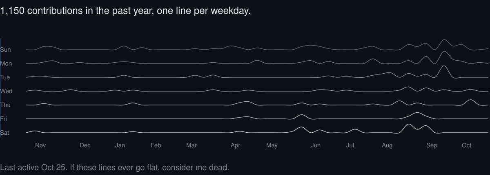

<picture>
  <source media="(prefers-color-scheme: dark)" srcset="./assets/header-dark.svg">
  <source media="(prefers-color-scheme: light)" srcset="./assets/header-light.svg">
  
</picture>

```ts
const ahmad = {
  role:     "Associate Software Engineer",
  at:       "InfiniteGoose",

  ships: [
    "AI SaaS products",
    "LLM workflows",
    "AI video + voice pipelines",
  ],
  stack: {
    web: ["React", "TypeScript", "Vue"],
    api: ["FastAPI", "Python"],
    ai:  ["LangGraph", "OpenRouter"],
    ops: ["Docker"],
  },

  research: {
    interests: [
      "machine learning", "AI systems",
      "security", "computer vision",
    ],
    published: "IEEE Access, 2026",
  },
  studied:  "BS Computer Science · CGPA 3.90",

  openTo: ["AI product builds", "research collaborations"],
};
```

<picture>
  <source media="(prefers-color-scheme: dark)" srcset="./assets/signal-dark.svg">
  <source media="(prefers-color-scheme: light)" srcset="./assets/signal-light.svg">
  
</picture>

<p align="center"><sub>redrawn every day from my contribution graph</sub></p>

<p align="center">
  
</p>

<p align="center">
  <a href="https://ahmads.dev">ahmads.dev</a> &nbsp;·&nbsp;
  <a href="https://www.linkedin.com/in/ahmadshahbazzz">LinkedIn</a> &nbsp;·&nbsp;
  <a href="mailto:ahmadshahbazz@outlook.com">Email</a> &nbsp;·&nbsp;
  <a href="https://doi.org/10.1109/ACCESS.2026.3742666">Paper</a> &nbsp;·&nbsp;
  <a href="https://orcid.org/0009-0007-7334-8584">ORCID</a>
</p>
